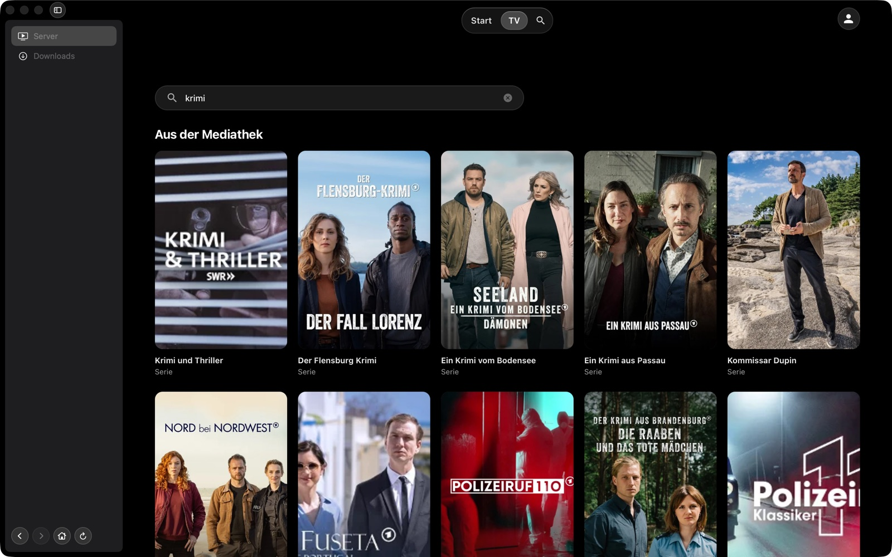
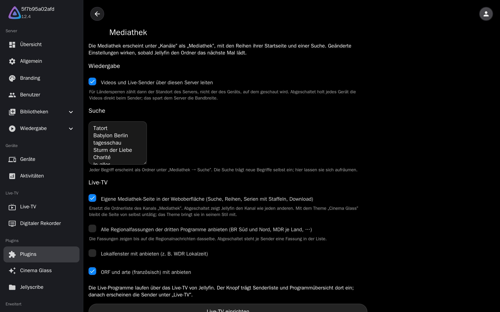

# Mediathek für Jellyfin

  
  
  
  
  

Ein Plugin für [Jellyfin](https://jellyfin.org), das die ARD Mediathek und die Live-Programme der öffentlich-rechtlichen Sender in den eigenen Server holt:

- **Mediathek als Kanal**: Unter „Kanäle“ erscheint „Mediathek“ mit den Reihen, die die Mediathek gerade auf ihrer Startseite zeigt (Serien, Filme, Dokus, …), und einer Suche. Serien haben Staffeln und Folgen, alles mit Plakaten, Bildern und Beschreibungen.
- **Live-TV**: Die Live-Programme laufen über das Live-TV von Jellyfin, mit Programmübersicht samt Bildern für die Programme der ARD-Familie, ZDF, ZDFneo, ZDFinfo, 3sat, arte (auch französisch), KiKA, phoenix und die Deutsche Welle. Sender, die der Server sicher nicht empfangen kann (Ländersperre), bleiben aus der Liste; von den Dritten mit mehreren Regionalfassungen erscheint eine. Das erste Einschalten bereitet das Plugin im Hintergrund vor, und jeder Sender beginnt mit rund zwanzig Sekunden Vorrat: Das Bild steht nach wenigen Sekunden, und kurze Aussetzer der Leitung führen nicht gleich zu Hängern (dafür liegt das Bild etwa zwanzig Sekunden hinter dem Live-Signal).
- **Eigene Seite in der Weboberfläche**: Der Kanal „Mediathek“ öffnet statt einer Ordnerliste eine Seite mit Suche, den Reihen der Mediathek, Serien mit Staffeln und einem Download-Knopf (im Browser). Sie übernimmt Farben und Schrift des gewählten Jellyfin-Designs und lässt sich in den Einstellungen abschalten. Die Sender bleiben in Jellyfins Bereich „Live TV“. Mit dem Theme [Cinema Glass](https://github.com/derpfiff/cinema-glass) erscheint dieselbe Seite in dessen Stil, dazu Downloads in der Jellyfin-App und in JellyDesk.
- **Über den eigenen Server**: Auf Wunsch (Voreinstellung) laufen Videos und Live-Sender durch den Server. Für Ländersperren zählt dann sein Standort, und es lässt sich wie gewohnt im Video springen.

| | |
|---|---|
| **Live-TV und Mediathek auf einer Seite** (hier im Theme [Cinema Glass](https://github.com/derpfiff/cinema-glass))  | **Mediathek wie eine Bibliothek** – Reihen, Suche, Serien mit Staffeln  |

Bilder und Texte in den Bildschirmfotos stammen aus der ARD Mediathek bzw. von TMDb und gehören den jeweiligen Rechteinhabern.

Das Plugin braucht keine Zugangsdaten und speichert keine Videos. Titel, Bilder und Videoadressen kommen von der ARD Mediathek, die Adressen der Live-Sender aus der Filmliste von [MediathekView](https://mediathekview.de) über [MediathekViewWeb](https://mediathekviewweb.de).

Stand: 0.3.4. Gebaut und geprüft gegen Jellyfin 12.4.

## Einrichten

1. In Jellyfin unter Dashboard → Plugins → Katalog → Einstellungen ein Repository hinzufügen, im Katalog „Mediathek“ installieren und Jellyfin neu starten. Als Adresse dient entweder `https://raw.githubusercontent.com/derpfiff/jellyfin-plugins/main/manifest.json` (gemeinsamer Katalog mit Cinema Glass und Jellyscribe) oder `https://raw.githubusercontent.com/derpfiff/jellyfin-mediathek/main/manifest.json` (nur dieses Plugin).
2. In den Einstellungen des Plugins „Live-TV einrichten“ drücken. Das trägt Senderliste und Programmübersicht im Live-TV ein; ein zweiter Druck legt nichts doppelt an.
3. „Sender prüfen“ auf derselben Seite zeigt, welche Sender dieser Server empfängt und woran es bei den übrigen liegt (meist eine Ländersperre).
4. Der Kanal „Mediathek“ erscheint, sobald Jellyfin seine Kanäle aktualisiert hat (geplante Aufgabe „Kanäle aktualisieren“, läuft auch von selbst).

Das Theme [Cinema Glass](https://github.com/derpfiff/cinema-glass) fasst Live-TV und Mediathek ab Version 1.4.0 zu einer eigenen TV-Seite zusammen; nötig ist es nicht.

## Grenzen

- Einzelne Titel sind nur in Deutschland abrufbar. Steht der Server im Ausland, hilft die Einstellung „über diesen Server leiten“ nicht; steht er in Deutschland (oder hinter einem deutschen VPN), laufen sie überall.
- Titel, die es nur als gestückelten Stream gibt (kein MP4), fehlen noch.
- Jellyfin merkt sich den Inhalt eines Kanal-Ordners eine Weile; das Plugin lässt die Startseite stündlich neu laden.
- Die Mediathek des ZDF ist noch nicht dabei; seine Sender und ihr Programm schon.
- Für Deutsche Welle und arte (französisch) gibt es keine Programmübersicht.

## Bauen

Vier Bibliotheken des eigenen Servers nach `plugin/lib` kopieren (`MediaBrowser.Common.dll`, `MediaBrowser.Controller.dll`, `MediaBrowser.Model.dll`, `Jellyfin.Database.Implementations.dll`, aus `/jellyfin` im Container), dann `sh plugin/build.sh`. Das Ergebnis liegt in `plugin/out/Jellyfin.Plugin.Mediathek.dll` und gehört in einen Ordner unter `plugins/` des Servers. `sh plugin/package.sh` packt es zusätzlich für den Katalog.

## Schnittstellen

Für Oberflächen, die die Mediathek selbst darstellen wollen. Die ersten vier verlangen eine Anmeldung.

| Adresse | Zweck |
|---|---|
| `GET /Mediathek/home` | Reihen der Startseite (Kennung, Titel, Anzahl) |
| `GET /Mediathek/row?id=…` | Titel einer Reihe, als Jellyfin-Titel |
| `GET /Mediathek/search?q=…` | Suche in der Mediathek, als Jellyfin-Titel |
| `GET /Mediathek/children?id=…` | Staffeln oder Folgen einer Sendung (Kennung des Ordners in Jellyfin), vollständig und in der Reihenfolge der Mediathek |
| `GET /Mediathek/resume` | Angefangene Titel der Mediathek, zuletzt gesehene vorn |
| `GET /Mediathek/download?id=…` | Adresse, unter der der Server die beste Fassung eines Titels als Datei durchreicht |
| `GET /Mediathek/download/progress?key=…` | Stand eines laufenden Downloads (Schlüssel aus `download`) |
| `POST /Mediathek/live/setup` | Live-TV einrichten (Administratoren) |
| `POST /Mediathek/live/warmup` | Sender für schnelles Einschalten vorbereiten (läuft sonst von selbst; Administratoren) |
| `GET /Mediathek/live/status` | Empfang je Sender von diesem Server aus (Administratoren) |
| `GET /Mediathek/live.m3u` | Senderliste für den M3U-Tuner von Jellyfin |
| `GET /Mediathek/guide.xml` | Programmübersicht (XMLTV) |
| `GET /Mediathek/live/…`, `/Mediathek/vod/…`, `/Mediathek/img/…` | Live-Sender, Videos und Bilder, durch den Server gereicht |
| `GET /Mediathek/play/…` | Titel abspielen; die Adresse beim Sender wird erst bei diesem Abruf herausgesucht |

Durchgereicht wird nur, was der Server selbst ausgegeben hat: jede dieser Adressen trägt eine Prüfsumme mit einem Schlüssel, den das Plugin beim ersten Start würfelt. Als offener Proxy lässt es sich nicht benutzen.

## Verwandte Projekte

- [Cinema Glass](https://github.com/derpfiff/cinema-glass): Oberfläche für Jellyfin; macht aus Live-TV und Mediathek eine TV-Seite
- [jellyfin-plugins](https://github.com/derpfiff/jellyfin-plugins): gemeinsamer Plugin-Katalog
- [JellyDesk](https://github.com/derpfiff/JellyDesk): Mac-App, lädt auch Mediathek-Titel herunter

Dieses Projekt ist kein offizielles Angebot von Jellyfin, der ARD, MediathekView oder einem der Sender.
